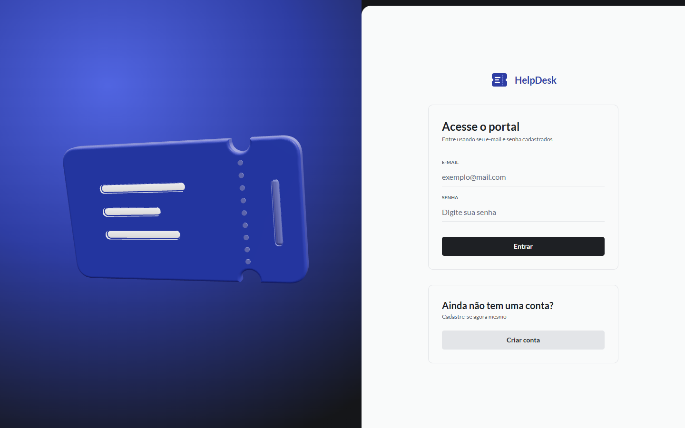
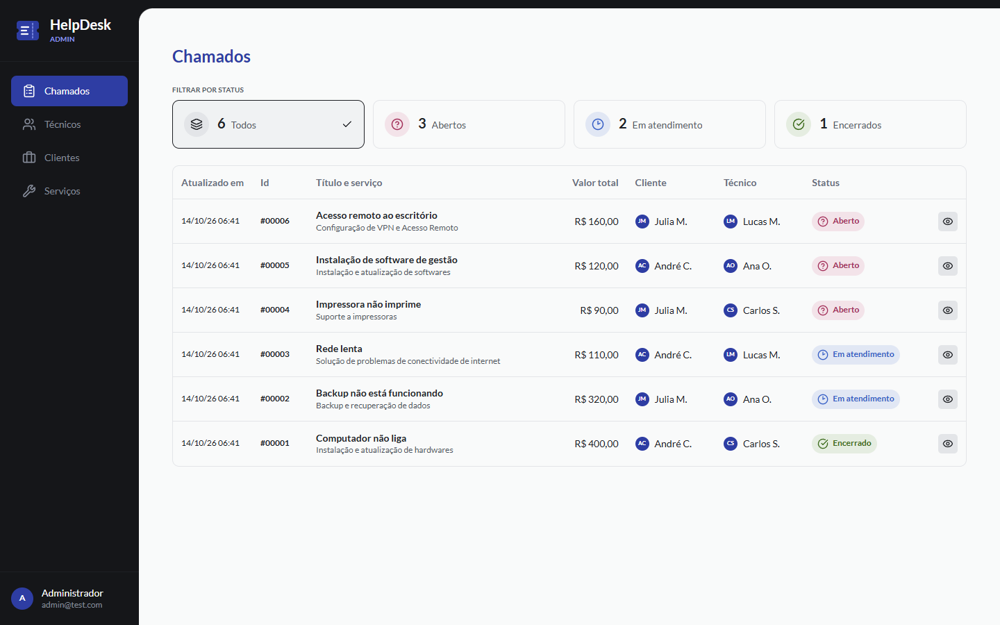
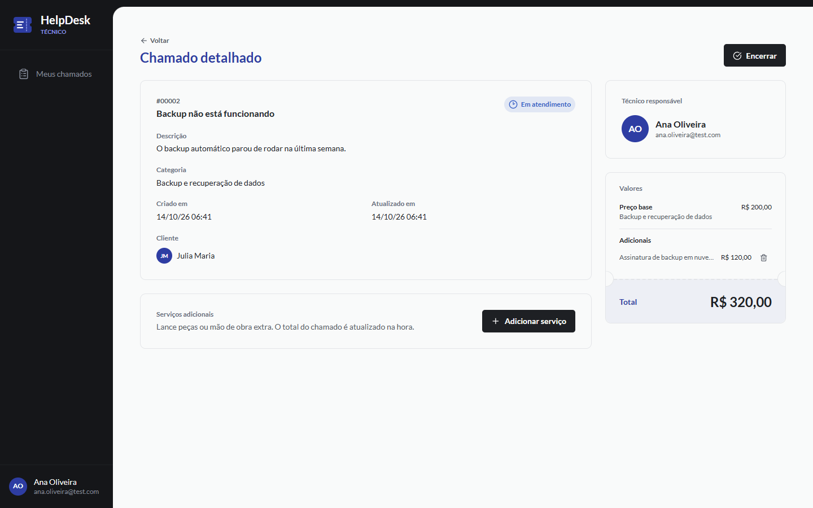
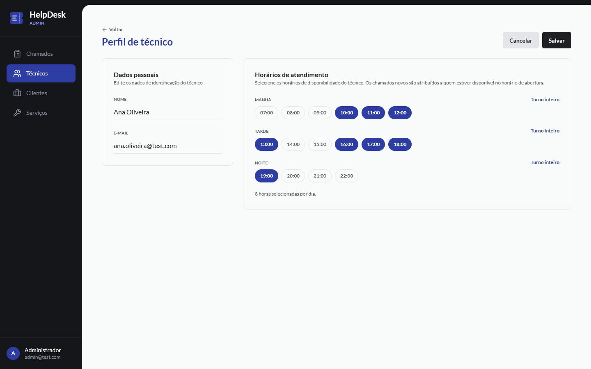
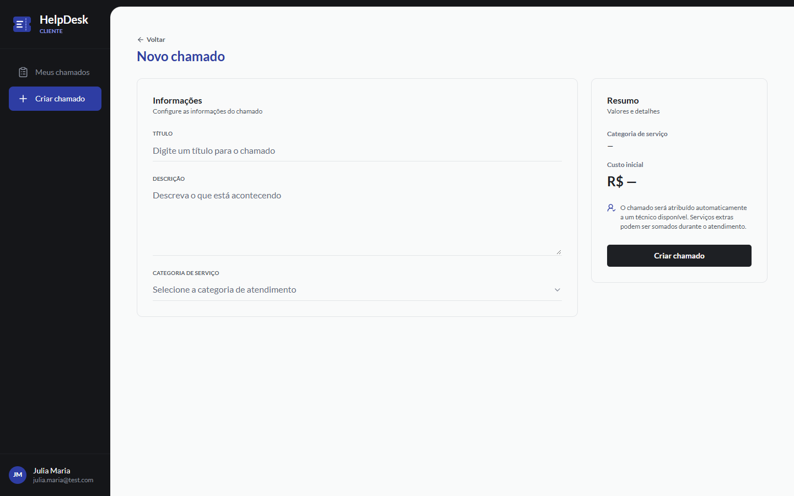
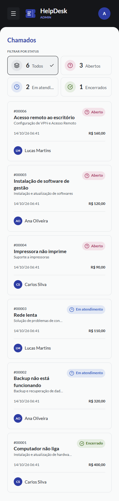
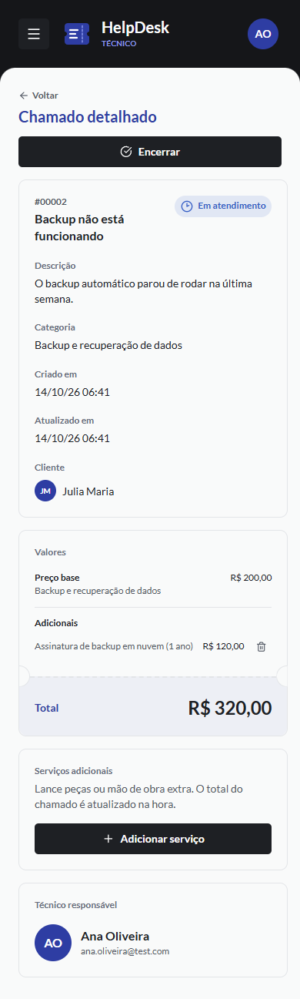

# HelpDesk — Sistema de Gerenciamento de Chamados

Aplicação full-stack com três perfis (Administrador, Técnico e Cliente). A especificação completa está em [BRIEFING-HELPDESK.md](BRIEFING-HELPDESK.md).

| Pacote | Stack |
|---|---|
| [`api/`](api/) | Node.js + Express + Prisma (PostgreSQL) + Zod + JWT + Jest |
| [`web/`](web/) | Vite + React + TypeScript + TailwindCSS |

> **Deploy**: os links públicos entram aqui depois de publicar a API no Render e o front na Vercel (passo a passo em [Deploy](#deploy)).

| Login (cena 3D) | Admin: chamados |
|---|---|
|  |  |
| **Técnico: detalhe com resumo de valores** | **Admin: horários do técnico** |
|  |  |
| **Cliente: novo chamado** | **Mobile** |
|  |   |

## Executando localmente

Pré-requisitos: Node.js 22+ e Docker.

```bash
# 1. Banco de dados (PostgreSQL 16, cria também o banco helpdesk_test)
docker compose up -d

# 2. API
cd api
cp .env.example .env
cp .env.test.example .env.test
npm install            # também roda `prisma generate`
npm run db:migrate     # aplica as migrations
npm run db:seed        # popula com dados de exemplo
npm run dev            # http://localhost:3333

# Testes (usam o banco helpdesk_test)
npm test

# 3. Front-end (em outro terminal)
cd web
cp .env.example .env   # VITE_API_URL=http://localhost:3333
npm install
npm run dev            # http://localhost:5173
```

**Sem Docker?** Rode `npm run db:local` em `api/`. Ele sobe um PostgreSQL 16 embutido (pacote `embedded-postgres`) em `localhost:5432`, já com os bancos `helpdesk` e `helpdesk_test`, e os demais passos são os mesmos.

### Contas de teste (seed)

Todas usam a senha `123456`.

| Perfil | E-mail | Observação |
|---|---|---|
| Admin | admin@test.com | |
| Técnico | carlos.silva@test.com | 08–12 e 14–18 |
| Técnico | ana.oliveira@test.com | 10–14 e 16–20 |
| Técnico | lucas.martins@test.com | 12–16 e 18–22 |
| Cliente | andre.costa@test.com | |
| Cliente | julia.maria@test.com | |

O seed não faz nada se `admin@test.com` já existir (pode ser rodado de novo sem duplicar dados).

## API

Base local: `http://localhost:3333`. Todas as rotas, exceto `POST /sessions` e `POST /users`, exigem `Authorization: Bearer <token>`.

| Método | Rota | Acesso |
|---|---|---|
| POST | `/sessions` | público |
| POST | `/users` | público (cadastro de cliente) |
| GET / PUT / DELETE | `/profile` | autenticado (DELETE só cliente) |
| PATCH | `/profile/password` | autenticado |
| PATCH / DELETE | `/profile/avatar` | autenticado (multipart, campo `avatar`) |
| GET / POST | `/technicians` | admin |
| GET / PUT | `/technicians/:id` | admin |
| GET | `/clients` | admin |
| PUT / DELETE | `/clients/:id` | admin |
| GET | `/services` | autenticado (cliente vê só ativos; `?active=` para os demais) |
| POST / PUT | `/services`, `/services/:id` | admin |
| PATCH | `/services/:id/status` | admin |
| GET | `/tickets` | todos (escopo por papel; `?status=`) |
| GET | `/tickets/:id` | dono, técnico atribuído ou admin |
| POST | `/tickets` | cliente |
| PATCH | `/tickets/:id/status` | técnico atribuído ou admin |
| POST | `/tickets/:id/additional-services` | técnico atribuído |
| DELETE | `/tickets/:id/additional-services/:serviceId` | técnico atribuído |
| GET | `/uploads/:file` | estático |

As listagens aceitam `?page=&perPage=` (padrão 1 e 10, máximo 100) e respondem `{ data, meta: { page, perPage, total, totalPages } }`. Os erros seguem o formato `{ message, issues? }`. Os chamados vêm com `servicePrice` (preço do serviço na abertura), `additionalTotal` e `total`, já calculados.

## Front-end

- **Tokens do Figma** em [web/src/styles/index.css](web/src/styles/index.css) (`@theme` do Tailwind v4). A paleta padrão do Tailwind é zerada, então nenhuma cor fora do sistema pode ser usada no JSX.
- **Rotas por papel**: `AuthRoutes`, `AdminRoutes`, `TechnicianRoutes` e `ClientRoutes` ([web/src/routes](web/src/routes)). Os painéis são carregados sob demanda depois do login.
- **Camada 3D** ([web/src/components/three](web/src/components/three)):
  - Ticket 3D no painel do login e cadastro.
  - Objeto 3D girando nos estados vazios.
  - Inclinação (tilt) nos cards de status do admin, com framer-motion e sem WebGL.
  - Flip 3D em CSS no badge quando o status muda.
  - Regras: tudo carregado com `React.lazy` e fallback estático. O 3D desliga com `prefers-reduced-motion`, abaixo de 768 px e com GPU por software. O three.js não entra no bundle inicial.
- **Qualidade medida**:
  - Lighthouse mobile no login: Performance 96, Acessibilidade 100, Boas práticas 100.
  - axe-core (WCAG 2.1 AA): 0 violações em 14 telas, desktop e mobile.

## Deploy

### API e banco no Render

1. No Render, crie um **Blueprint** apontando para este repositório. O [render.yaml](render.yaml) cria o Web Service `helpdesk-api` (Docker, `api/Dockerfile`) e o PostgreSQL 16 `helpdesk-db`.
2. Preencha `CORS_ORIGIN` com a URL do front na Vercel. `JWT_SECRET` é gerado automaticamente e `DATABASE_URL` vem do banco.
3. O container roda `prisma migrate deploy` a cada start.
4. **Seed** (uma vez): a imagem de produção não inclui as ferramentas de desenvolvimento, então rode o seed da sua máquina contra a *External Database URL* do Render:
   ```bash
   cd api
   DATABASE_URL="<external database url do Render>" npm run db:seed
   ```

> **Avatares e disco efêmero.** O disco do Web Service do Render é apagado a cada deploy ou reinício, e os arquivos em `uploads/` vão junto: o usuário fica com um `avatar` apontando para um arquivo que não existe. O front cai nas iniciais automaticamente. Para manter as fotos, anexe um **Persistent Disk** ao serviço (planos pagos), montado em `/app/uploads` ou no caminho definido em `UPLOADS_DIR`, ou troque o storage do multer por um serviço externo (S3, Cloudinary).

### Front na Vercel

1. Importe o repositório na Vercel com **Root Directory = `web`**. O framework Vite é detectado e o [vercel.json](web/vercel.json) já faz o rewrite de SPA para `index.html`.
2. Defina `VITE_API_URL` com a URL da API no Render (sem barra no final).
3. Volte ao Render e confira se `CORS_ORIGIN` tem a URL final da Vercel.

## Decisões

Pontos que o briefing não define, resolvidos pela opção mais simples:

1. **Métricas do admin**: os 3 cards (abertos / em atendimento / encerrados) ficam no topo da tela *Chamados* do admin, já que o briefing não prevê uma tela de dashboard.
2. **3D em estados vazios**: o objeto 3D só aparece quando a lista está vazia, no lugar dela, nunca junto com linhas de tabela.
3. **Fuso da atribuição automática**: `America/Sao_Paulo` (variável `TZ_BUSINESS`). O bloco `"08:00"` cobre de 08:00 a 08:59.
4. **Carga do técnico**: número de chamados `open` + `in_progress`. Entre vários técnicos disponíveis, vence o de menor carga; o empate é decidido pelo cadastro mais antigo.
5. **Transições de status**: o técnico só avança um passo por vez (`open → in_progress → closed`); o admin pode definir qualquer status.
6. **Serviços adicionais**: só podem ser adicionados ou removidos com o chamado em `in_progress`.
7. **Excluir cliente** apaga os chamados dele (cascade do schema); o modal de confirmação avisa isso.
8. **Técnicos não são excluídos** (não há rota para isso).
9. **O admin não troca a senha do técnico**: `PUT /technicians/:id` edita nome, e-mail e horários.
10. **Senha**: mínimo de 6 caracteres.
11. **`GET /services`**: o cliente vê só os ativos; técnico e admin veem todos (filtro opcional `?active=`).
12. **Schemas Zod do front** duplicados em `web/src/lib/schemas.ts` (em vez de um pacote compartilhado), para manter os deploys de Render e Vercel independentes.
13. **Disponibilidade**: blocos com início entre 07:00 e 22:00. Na grade do front: manhã 07–12, tarde 13–18, noite 19–22.
14. **Valores dos serviços no seed** (o briefing não define): softwares R$ 120, hardwares R$ 180, vírus R$ 150, impressoras R$ 90, periféricos R$ 80, conectividade R$ 110, backup R$ 200, otimização do SO R$ 130, VPN R$ 160.
15. **Testes**: o `globalSetup` aplica as migrations com `prisma migrate deploy` no banco de teste e cada suíte limpa as tabelas com `TRUNCATE`. Não usamos `migrate reset`.
16. **Sem técnicos cadastrados**: a criação de chamado responde 503 ("Nenhum técnico cadastrado"), já que não há a quem atribuir.
17. **Métricas do admin**: são obtidas por `GET /tickets?status=<x>&perPage=1` (lendo `meta.total`), sem criar uma rota extra fora do briefing.
18. **Figma sem MCP**: o MCP do Figma não estava conectado durante a construção. Os tokens (cores, Lato, escala, raios) foram reconstruídos a partir do arquivo de referência e precisam ser conferidos quando o MCP for conectado. Quatro tokens extras (`*-ink` e `muted`) escurecem o texto dos badges e os rótulos secundários para atingir contraste AA.
19. **Perfil em modal**: "Perfil" abre um modal a partir do menu do usuário, como no Figma, em vez de uma rota própria. A troca de senha abre um segundo modal.
20. **Cadastro entra direto**: depois do cadastro, o cliente já é autenticado e cai em "Meus chamados".
21. **Cards de métricas como filtro**: no admin, os cards Todos, Abertos, Em atendimento e Encerrados também filtram a tabela.
22. **Sem Docker nesta máquina**: o desenvolvimento usou `npm run db:local` (PostgreSQL embutido). O `docker-compose.yml` e o `api/Dockerfile` seguem o briefing, mas não foram executados aqui.
